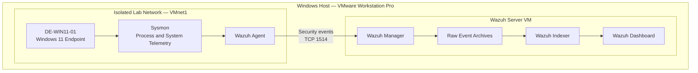

# Detection Engineering Lab — Architecture

## 1. Overview

This project is a local detection engineering lab built to develop practical skills in security telemetry collection, detection rule development, alert validation, and investigation using open-source security tools.

The lab runs on VMware Workstation Pro and uses Wazuh as the central security monitoring platform. A Windows 11 endpoint generates security telemetry through Sysmon, while the Wazuh agent forwards collected events to the Wazuh server for storage and analysis.

The environment is designed to support future detection engineering exercises, including custom detection rules, false-positive testing, MITRE ATT&CK mapping, web application monitoring, and cloud security telemetry.

## 2. Architecture Diagram

*Note: This diagram represents the intended logical telemetry flow. The Windows-to-Wazuh agent connection has been tested successfully, and raw Sysmon events have been verified in Discover. The exact internal archive-to-indexer processing path may include Filebeat and should be validated against the installed configuration.*

## 3. Lab Components

| Component | Configuration | Purpose |
|---|---|---|
| Hypervisor | VMware Workstation Pro | Runs the lab virtual machines |
| SIEM server | Ubuntu Server 24.04 | Hosts the Wazuh all-in-one deployment |
| Endpoint | Windows 11 VM | Generates endpoint security events |
| Telemetry source | Sysmon 15.22 | Captures detailed Windows system activity |
| Endpoint collector | Wazuh Agent | Collects and forwards configured event channels |
| SIEM manager | Wazuh Manager | Receives and processes endpoint events |
| Search and storage | Wazuh Indexer and Filebeat | Supports event indexing and search |
| Investigation interface | Wazuh Dashboard | Enables log analysis and alert investigation |

## 4. Network Design

The lab uses separate VMware network interfaces to distinguish management/internet connectivity from isolated endpoint communication.

| Network | Subnet / Address | Purpose |
|---|---|---|
| VMware NAT — VMnet8 | `192.168.49.0/24` | Internet connectivity for the Ubuntu server |
| Ubuntu NAT interface | `192.168.49.136` | DHCP-assigned address at the time of documentation |
| VMware Host-only — VMnet1 | `192.168.64.0/24` | Isolated communication between the host and lab VMs |
| Host virtual adapter | `192.168.64.1` | Host access to the VMnet1 network |
| Ubuntu host-only interface | `192.168.64.10` | Stable lab-side address for the Wazuh server |

The Windows endpoint uses the VMnet1 host-only network. The Ubuntu server has both NAT and host-only interfaces.

**Security design principles:**

- Keep lab endpoints isolated from the physical LAN.
- Do not use bridged networking for vulnerable or intentionally exposed lab systems.
- Use the host-only address `192.168.64.10` for Windows-to-Wazuh communication where applicable.
- Confirm the current addresses before troubleshooting because NAT DHCP addresses can change.
- Add firewall restrictions and dedicated network segments as the lab grows.

## 5. Telemetry Flow

The current Windows endpoint telemetry pipeline is:

1. A user or test process generates activity on Windows 11.
2. Sysmon records supported events in `Microsoft-Windows-Sysmon/Operational`.
3. The Wazuh agent collects the configured event channel.
4. The agent forwards events to the Wazuh manager over TCP port `1514`.
5. The Wazuh manager processes the incoming events.
6. Raw event archiving and Filebeat archive indexing make the configured event data searchable.
7. The analyst uses Wazuh Discover to investigate events and validate telemetry.

## 6. Current Implementation Status

### Completed and verified

- Ubuntu Server 24.04 VM deployed.
- Wazuh all-in-one installation completed.
- Windows 11 endpoint connected to the host-only lab network.
- Wazuh agent registered as `DE-WIN11-01` (agent ID `001`).
- Agent status confirmed as active.
- Sysmon 15.22 installed and running.
- Sysmon Event ID 1 process-creation events verified locally.
- Wazuh agent configured to collect the Sysmon Operational event channel.
- TCP connectivity to the Wazuh agent communication port tested successfully.
- Raw event archiving and archive indexing enabled.
- Notepad and Calculator activity observed in Wazuh Discover.

### Planned enhancements

- Develop and validate custom Wazuh detection rules.
- Test detection logic with controlled positive and negative cases.
- Map appropriate detections to MITRE ATT&CK.
- Add Linux and web application telemetry.
- Document detection tests and investigation findings.
- Explore Sigma-based detection workflows where supported.
- Add cloud security telemetry and local AI-assisted detection development.

These enhancements are planned and should not be considered completed until implemented and tested.

## 7. Detection Engineering Workflow

The lab will follow this repeatable workflow:

1. **Define:** Identify a behavior or threat technique to detect.
2. **Generate:** Produce controlled test activity in the lab.
3. **Collect:** Verify the relevant telemetry reaches Wazuh.
4. **Develop:** Create or tune the detection logic.
5. **Validate:** Confirm expected behavior produces an alert.
6. **Test negatives:** Check benign activity and potential false positives.
7. **Map:** Associate the detection with MITRE ATT&CK when appropriate.
8. **Document:** Record the rule, test procedure, expected result, actual result, and limitations.
9. **Improve:** Refine the detection and repeat the tests.

## 8. Operational Considerations

### Raw log storage

Raw event archiving is enabled for learning and investigation. This can increase disk usage, so archive size and available disk space should be monitored.

### Alert data versus raw events

Raw events and security alerts serve different purposes:

- Raw archives support investigation and telemetry validation.
- Alert indexes contain events that have generated Wazuh alerts.

An event being visible in the archive does not automatically mean a detection rule has generated an alert.

### Security and evidence

Screenshots, configuration files, and example events should be reviewed before publication. Remove passwords, enrollment keys, tokens, personal information, and other sensitive values from public repository content.

## 9. Project Scope

The initial scope is endpoint telemetry ingestion and detection engineering using Wazuh and Sysmon. Additional telemetry sources and cloud integrations will be introduced incrementally after the current pipeline is stable.

The project is intended for authorized lab testing and skill development.

## 10. Current Limitations

- The current documented endpoint is Windows 11.
- Custom detection rules have not yet been validated as part of this milestone.
- False-positive and negative-test results are pending.
- Linux, web application, and cloud telemetry integrations are future work.
- The NAT address shown in this document is time-sensitive and may change.

## 11. Next Milestone

Develop the first custom Wazuh detection rule using a controlled Windows test case. Validate the expected alert, test benign activity, capture evidence, and document the results in the repository.
